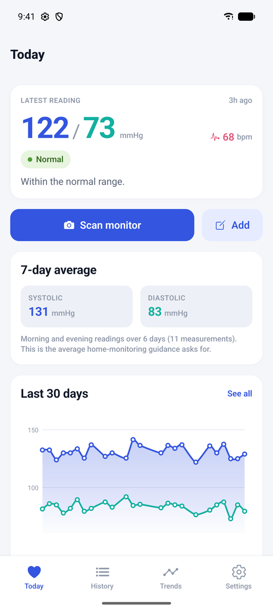
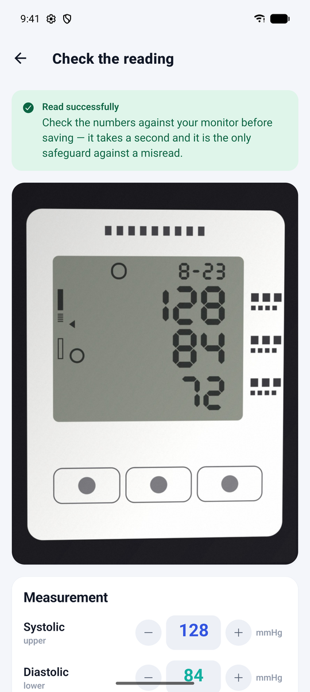
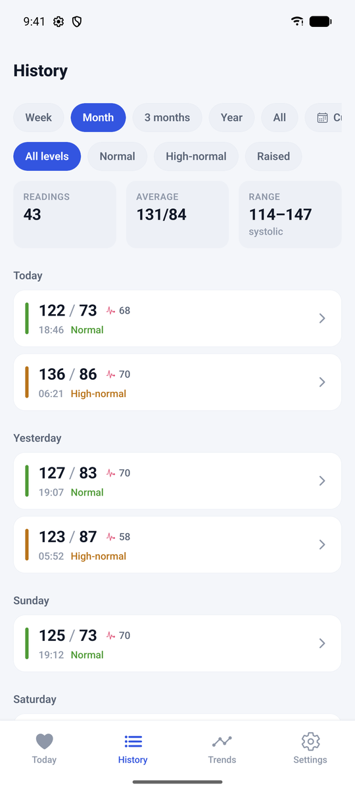
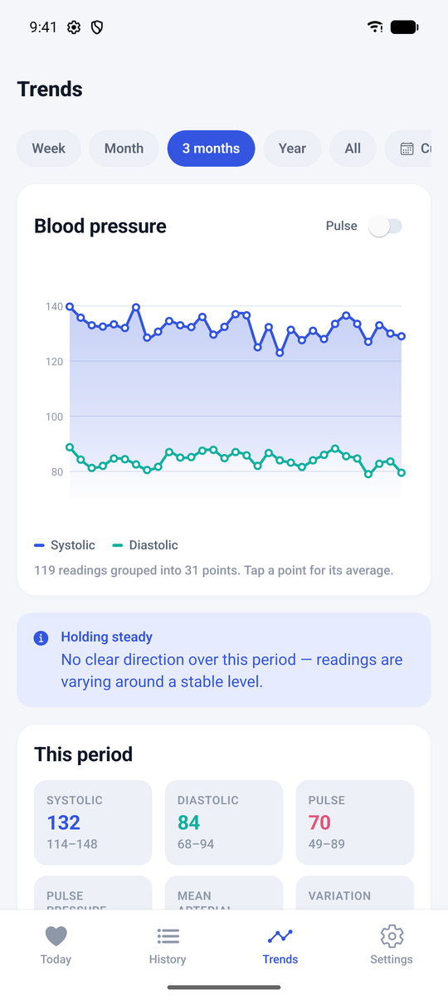
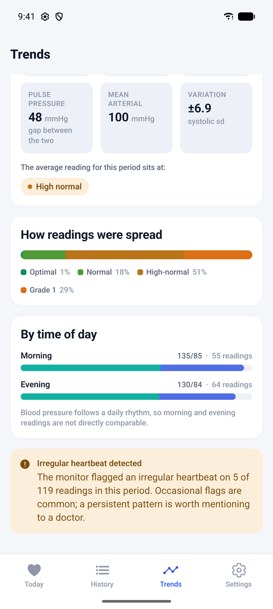
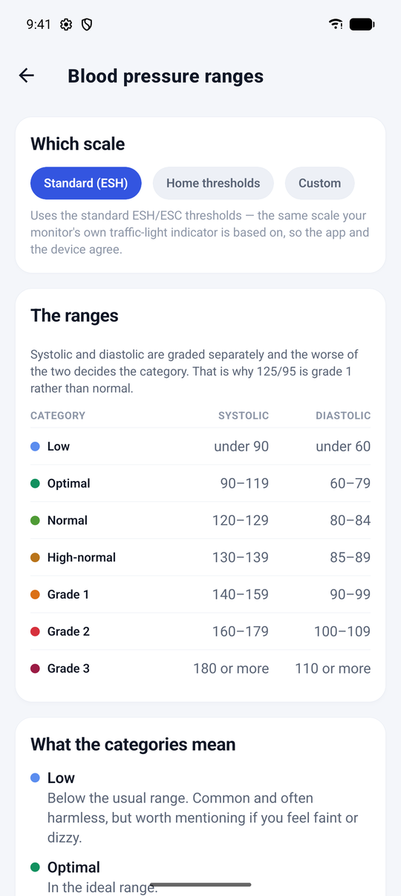
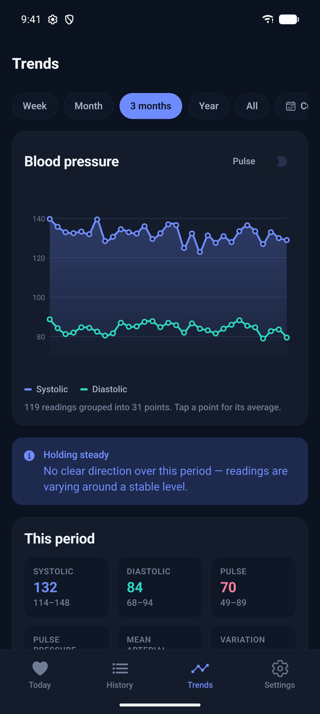

# Heart History

Point your phone at a blood-pressure monitor. Heart History reads the numbers off
the display, keeps the history, and draws the charts. All of it runs on the
phone unless you set up assisted reading yourself.

Built and tested against the **Microlife BP B1 Classic**. Other monitors with a
seven-segment display may work, but none has been tried.

[](LICENSE)


| Today | Check a scan | History | Trends |
|:---:|:---:|:---:|:---:|
|  |  |  |  |

| Insights | Ranges | Dark mode |
|:---:|:---:|:---:|
|  |  |  |

<sub>The screenshots show generated demo data from `tools/seed-demo.ts`. The
scanned display is a synthetic render from `tools/render-display.ts`, read by
the on-device recogniser.</sub>

## Where it stands

The app itself works: history, charts, backups, the doctor's report and manual
entry.

Reading the display *on the phone* only works on clean, straight-on photos. In
testing it read 2 of 33 hand-held ones and refused the rest. It never saved a
wrong number, so in practice you will often type the values in yourself.
[Assisted reading](#assisted-reading) closes that gap if you have a PC with a
GPU to run a vision model on.

## What it does

- **Scan a reading.** Photograph the display, or pick a photo you already took.
  Systolic, diastolic and pulse are filled in for you to confirm. Nothing is
  saved until you do.
- **Or type it in.** Manual entry needs no photo. You can also note the arm,
  your posture, tags, a note, and whether the monitor flagged an irregular
  heartbeat. Every reading can be edited or deleted later.
- **See where you stand.** The home screen shows the latest reading, a 30-day
  chart, and the 7-day morning-and-evening average that home-monitoring
  guidance asks for.
- **See the history.** Readings are grouped by day. Filter by last week, month,
  3 months, year, all time or any two dates, and by how raised the reading was.
- **See the trends.** Systolic and diastolic over time, with pulse optional. You
  also get:
  - which way the numbers are heading
  - pulse pressure, mean arterial pressure and variation
  - how readings spread across the categories
  - averages by time of day
  - a note when irregular-heartbeat flags turn up
- **Keep it safe.** Back up to JSON, export CSV, or print a PDF report for a
  doctor's appointment. Restore by merging with what you have or by replacing
  it.
- **Know what the colours mean.** One screen lists every category with its
  systolic and diastolic range and what it describes. You can choose the
  standard ESH scale, home-measurement thresholds, or your own if a clinician
  gave you different ones.
- **Share the monitor.** Each profile gets its own history and an optional
  personal target line on the charts. The category scale is shared across
  profiles.
- **Read it in your language.** German and English, plus *Automatic*, which
  follows the phone's language. German is the default. Dates follow your
  choice.
- **Light and dark.** Follows the system, or pick one.

## Privacy and the network

**By default, nothing leaves the phone.** The recogniser in `src/ocr/` is plain
TypeScript over typed arrays. It uses no native modules, makes no network calls
and needs no cloud service. The same source file runs on the phone under Hermes
and in Node under the test suite, which is what makes it testable at all.

`app.config.ts` removes `android.permission.INTERNET` from the Android manifest
of the `preview`, `production` and `production-apk` builds. Android enforces
that, so those builds *cannot* make a network request, whatever a future
dependency tries. Photos, readings and backups live in app-private storage. An
export only leaves the device when you pick a destination in the share sheet.

Two build profiles do have network access. Neither is the default, and both are
opt-in:

| Build | Network | Why |
|---|---|---|
| `preview`, `production`, `production-apk` | **none** | The default. Everything is on the device. |
| `development` | yes | Has to reach the Metro bundler to load JavaScript at all. |
| `assisted-apk` | yes | Can send photos to a reading server you run yourself (see below). |

**Assisted reading only turns on when you ask for it twice.** You need the
`assisted-apk` build, and you need to enter a server address in *Settings ›
Assisted reading*. Each scan then sends one photo: a JPEG re-encoded on the
phone, at most 1280 px on the long side, with your bearer token. No readings, no
history and no profile data go with it. If the server cannot be reached, the
phone reads the photo itself and tells you why. Clear the field and you are back
to on-device reading.

Two more things, so nothing here surprises you:

- Builds with network access also have Expo's update service configured
  (`updates` in `app.config.ts`), so they can check `u.expo.dev` for
  over-the-air updates. Builds without network access cannot.
- The network block is an Android manifest feature. Every build profile and
  script in this repo targets Android. While you develop in Expo Go, the app
  runs under Expo Go's own manifest, which does include `INTERNET`.

## How well does it read a display?

Two benchmarks, because they answer different questions.

**256 synthetic photos** with known ground truth (`npm run ocr:bench`), covering
capture conditions from ideal to unusable:

| Condition | Exact (all three values) | Wrongly accepted |
|---|---|---|
| Clean | 100% | 0 |
| Typical hand-held | 100% | 0 |
| Steep angle | 100% | 0 |
| Dim and grainy | 100% | 0 |
| Glare and heavy blur | 100% | 0 |
| Brutal | 100% | 0 |
| Severe | 97% | 0 |
| Genuinely unreadable | — | **0 of 32 accepted** |

These are generated, so they flatter the reader. The display always fills a
good part of the frame, which real photos often don't. They are good for
catching regressions, not for predicting real-world results.

**Real photographs of the monitor** (`npm run ocr:real`). Each one is read
through four different resize-and-re-encode chains, because the exact chain a
phone uses cannot be reproduced offline. On a marginal photo, a grey level or
two decides whether a segment reads as lit:

| Photo | Truth | Accepted | Read |
|---|---|---|---|
| Stored average, bright reflection | 117/81/81 | 1 of 4 | 117/81 |
| Straight-on, panel fading to the right | 122/79/98 | 1 of 4 | 122/79 |
| Low contrast, hard shadow over the glass | 107/78/98 | 2 of 4 | 107/78 |
| Power-on self test (all segments lit) | must refuse | 0 of 4 | — |

**Nothing wrong was ever accepted**, not in 256 synthetic images and not in 16
real reads. That is the column that matters. A blood-pressure log that silently
records a number you did not measure is worse than one that asks you to check.

### And where it stops working

Thirty-three later photographs, taken the way people actually take them, were
read through the same four chains (`npm run ocr:folders`). The monitor is small
in the frame, at an angle, and lit by a phone torch:

```
runs 132   accepted 5   correct 5   WRONG 0
```

**Two photographs out of thirty-three.** Still nothing wrong, but on the input
that matters it does not work as a reader. The cause is structural, not a matter
of tuning. Nothing in the pipeline finds the display or corrects perspective, so
a panel at a tenth of the frame and twenty degrees never reaches the code that
reads digits. [docs/ocr.md](docs/ocr.md) has the detail.

## Assisted reading

This is optional, off by default, and needs a PC of your own with a GPU. It runs
a vision model (Qwen3-VL-8B under llama.cpp), and the app sends the photo there
instead of reading it on the phone. On the 37 photos in `tools/fixtures/`:

| | On the phone | Assisted |
|---|---|---|
| Photos read | 5 of 37 | about 9 in 10 |
| Blood pressure wrong | 0 | **0** |
| Irregular-heartbeat symbol | not detected | found on every lit photo it read, no false alarms |
| Time per photo | under a second | about 15 s on an RTX 3060 |
| Needs | nothing | a PC you run, reachable from the phone |

These are from the author's own grading runs, written up in
[docs/assisted-reading.md](docs/assisted-reading.md). Every photo it did not
read, it refused rather than misread. Run `python tools/vlm-grade.py` against
your own server to measure it on your hardware.

Each photo is read from four renderings. A value is accepted only if at least
three of them name it and none names anything different. It is not decided by
majority, because on the hardest photo the majority was wrong, and that rule is
what keeps the wrong column at zero. A fifth, zoomed look votes only on the
irregular-heartbeat symbol.

The server keeps nothing. The photo lives in memory for one request. There is no
database and no upload directory, and even the console line leaves out the
values. History, photos and backups stay on the phone. Every endpoint requires a
bearer token, generated on first run. That lets the server sit behind a
Cloudflare tunnel instead of only on the LAN, with the trade-offs
[server/README.md](server/README.md#behind-a-cloudflare-tunnel) spells out.

The server scripts are PowerShell, so it runs on Windows as written. Setup is in
[server/README.md](server/README.md). The reasoning, including what was tried
and discarded, is in [docs/assisted-reading.md](docs/assisted-reading.md).

## Getting started

You need Node 20.19.4 or newer and either an Android device with
[Expo Go](https://expo.dev/go) or an Android emulator.

```bash
git clone https://github.com/Jiron/Heart-History.git
cd Heart-History
npm install
npm run android
```

`npm run android` starts Metro and opens the app in Expo Go. Everything works
there except restoring a backup, which is a limit of Expo Go itself.
[docs/building.md](docs/building.md#the-one-thing-expo-go-cannot-do) explains it
and shows how to run a real build instead.

## Building an APK

```bash
npm run build:apk
```

That builds a shareable, network-free APK on EAS, which needs a free
[expo.dev](https://expo.dev) account. `npm run build:apk:assisted` builds the
variant that can reach a reading server.

**Forking?** `app.config.ts` points at the original author's Expo project
(`extra.eas.projectId` and `updates.url`) and uses the Android package
`ch.opten.hearthistory`. Delete those two fields, run `npx eas-cli init` to link
your own project, and pick your own package id before you build.
[docs/building.md](docs/building.md) has the full instructions, including local
builds and Play Store bundles.

## Developing

```bash
npm test               # recogniser, classification and report test suites
npm run typecheck      # tsc --noEmit
npm run lint           # expo lint
npm run ocr:bench      # accuracy across synthetic capture conditions
npm run ocr:real       # accuracy against the real photos in tools/fixtures/
npm run ocr:folders    # accuracy against the hand-held photo folders
npm run ocr:debug      # render one synthetic display and dump annotated PNGs
```

[tools/README.md](tools/README.md) describes every development tool, including
how to add a real photo as a regression test.

## Documentation

| | |
|---|---|
| [requirements.md](docs/requirements.md) | The brief, and the decisions taken against it |
| [ocr.md](docs/ocr.md) | How the on-device recogniser works, and where it stops |
| [assisted-reading.md](docs/assisted-reading.md) | The local vision model: what was tried, measured and rejected |
| [architecture.md](docs/architecture.md) | Project layout and data model |
| [building.md](docs/building.md) | Running, testing and shipping |
| [roadmap.md](docs/roadmap.md) | Ideas worth building next |
| [server/README.md](server/README.md) | Running the assisted reader, and how it handles untrusted uploads |

## Contributing

Issues and pull requests are welcome. See [CONTRIBUTING.md](CONTRIBUTING.md) for
the one rule that matters most here. Security issues go through
[SECURITY.md](SECURITY.md) rather than a public issue.

## License

[MIT](LICENSE). Use it, change it, ship it, sell it. Just keep the copyright
notice.

## A word on what this is

Heart History records measurements. It is not a medical device and it does not
diagnose anything. The categories it shows describe a single reading, not a
person. What your readings mean is a conversation to have with a doctor.
